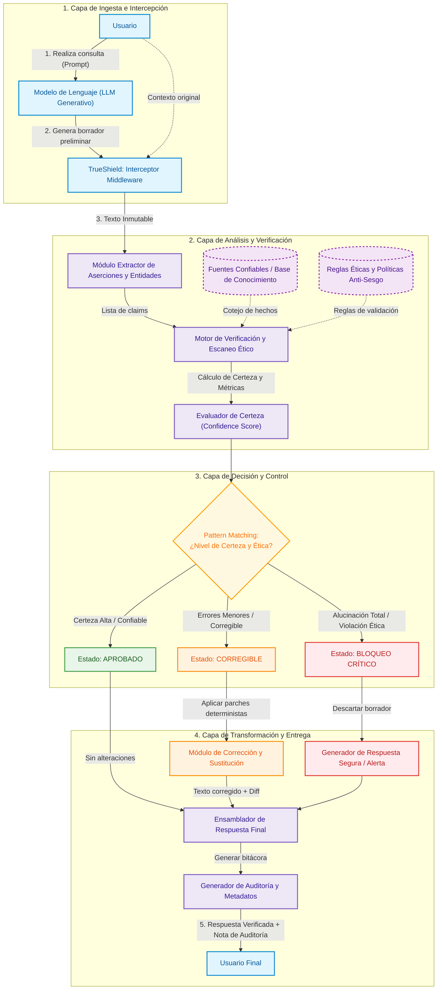

# Corrección de Alucinaciones en Modelos de Lenguaje

**PROYECTO DE IA AGÉNTICA**  
- **Materia:** Programación Funcional  
- **Docente:** Dr. Walter Alexander Mata López  
- **Alumno:** Briseida Adilene Hernandez Santos  

---

## PLANTEACIÓN DEL PROBLEMA

Los modelos de inteligencia artificial generativa a menudo sufren de **"alucinaciones"** (generación de datos falsos presentados como reales) y presentan sesgos discriminatorios (respuestas que perpetúan prejuicios de género, raza, religión o clase social). Esto representa un riesgo ético y operativo crítico cuando la IA se utiliza en áreas sensibles como educación, finanzas, recursos humanos o atención al cliente, donde entregar información errónea o discriminatoria puede causar graves daños a los usuarios.

---

## USUARIO

Estudiantes, empresas de tecnología y usuarios generales que requieren garantizar que las respuestas entregadas por sistemas de IA generativa sean 100% verídicas, seguras, éticas y libres de contenido discriminatorio o falso.

---

## FUNCIONAMIENTO GENERAL

| Paso | Descripción |
| :---: | :--- |
| **1** | El usuario hace una pregunta y la IA genera un borrador de respuesta. |
| **2** | Antes de que esa respuesta se muestre al usuario TrueShield la intercepta para revisarla. |
| **3** | TrueShield lee el texto de manera rápida extrae los datos importantes (como fechas, nombres, conceptos) y los compara con fuentes confiables. Al mismo tiempo escanea el texto para asegurase que no tenga comentarios ofensivos o discriminatorios. |
| **4** | Con base a la revisión, TrueShield decide que hacer, si todo esta bien, deja pasar la respuesta, pero si hay datos falsos o lenguaje inapropiados, el mismo la corrige o borra.<br><br>Si la respuesta es una mentita total la bloquea por completo. |
| **5** | Al fina el usuario recibe en la pantalla la respuesta ya limpia, verificada y con un pequeño aviso de dice si se le tuvo que hacer alguna corrección al texto original. |

---

## RESPONSABILIDAD DEL AGENTE

- **Analizar:** Leer el texto que generó la IA y separar los datos importantes También escanea si el lenguaje contiene sesgos o discriminación.
- **Decidir:** Evaluar qué tan confiable es la respuesta y elegir automáticamente una de tres opciones: aprobarla si todo es correcto, modificarla si tiene pequeños errores o lenguaje inadecuado, o bloquearla si es totalmente falsa o grosera.
- **Actuar:** Reescribir el texto con los cambios necesarios antes de mostrárselo al usuario y generar una nota rápida indicando qué partes se corrigieron.

---

## INFORMACIÓN NECESARIA

Para que TrueShield pueda trabajar solo necesitara tres cosas sencillas:

- **Entrada:** La pregunta que realizara el usuario y el borrador de respuesta que generara la IA.
- **Consulta:** Fuentes confiables (datos reales y confiables) junto con un conjunto de reglas éticas para evitar comentarios discriminatorios.
- **Salida de datos:** El historial de cambios que realizara el agente y el porcentaje de certeza de la información.

---

## RESULTADO ESPERADO

El usuario revisara una respuesta final totalmente segura y respetuosa, junto con un pequeño aviso que confirme que la información ya que fue revisada y corregida por el agente.

---

## VALOR DE LA PROPUESTA

Lo valioso de este proyecto es que no es un simple lector que solo avisara si algo esta mal, sino un agente activo que toma decisiones y corrige la información en cuestión de segundos de manera autónoma porque todo el proceso de recibir el texto, compararlo con fuentes confiables y filtrarlo y modificarlo se vuelve muy limpia.

---

## PASOS DEL FLUJO DE TRABAJO

El modelo de corrección opera a través de un flujo estructurado y determinista compuesto por cinco etapas secuenciales:

### 1. Etapa de Intercepción e Ingesta de Datos
- **Captura:** El agente actúa como una capa intermediaria (middleware) que intercepta la consulta emitida por el usuario ($Q$) y el borrador preliminar generado por el modelo de lenguaje generativo ($D_{draft}$).
- **Inmutabilidad de Entrada:** Los datos de entrada se encapsulan en estructuras de datos de solo lectura para garantizar que el estado original permanezca intacto durante todo el ciclo de análisis.

### 2. Etapa de Descomposición y Extracción de Aserciones
- **Segmentación Atómica:** El texto se descompone en oraciones y proposiciones lógicas individuales (aserciones o *claims*).
- **Extracción de Entidades y Hechos:** Se identifican entidades clave (nombres propios, fechas cronológicas, cifras estadísticas, relaciones de causalidad y conceptos técnicos).
- **Aislamiento Léxico:** Se separan las aserciones fácticas del tono estilístico para procesar exclusivamente los datos verificables.

### 3. Etapa de Verificación Fáctica y Escaneo Ético
- **Cotejo contra Fuentes Fidedignas (Ground Truth):** Cada aserción individual se compara contra bases de conocimiento estructuradas, bases de datos fácticas y motores de recuperación de información (RAG de alta precisión).
- **Evaluación de Sesgos y Toxicidad:** El texto se analiza contra un corpus declarativo de directrices éticas y políticas de no discriminación (género, raza, credo, condición socioeconómica).
- **Cálculo del Índice de Certeza ($C_{score}$):** Se calcula un coeficiente numérico de veracidad ($0.0 \le C_{score} \le 1.0$) basado en la consistencia de las fuentes y la ausencia de violaciones éticas.

### 4. Etapa de Evaluación y Toma de Decisiones
Mediante una evaluación por coincidencia de patrones (*Pattern Matching*), el agente categoriza el estado de la respuesta:
1. **Estado Válido ($C_{score} \ge \theta_{aprobado}$ sin infracciones éticas):** La respuesta es veraz y respetuosa; se aprueba directamente para su emisión sin modificaciones.
2. **Estado Corregible ($\theta_{min} \le C_{score} < \theta_{aprobado}$ o infracciones léxicas menores):** Se identifican las divergencias específicas (errores de fechas, cifras inexactas o términos desajustados) y se generan parches de sustitución deterministas.
3. **Estado Crítico / Alucinación Total ($C_{score} < \theta_{min}$ o toxicidad severa):** La información carece de sustento fáctico o atenta contra las políticas éticas; se cancela la respuesta y se conmuta a una respuesta de bloqueo seguro predefinida.

### 5. Etapa de Reescritura, Trazabilidad y Emisión
- **Reconstrucción Inmutable:** Si la respuesta es corregible, se aplican las transformaciones puntuales reemplazando las aserciones erróneas por datos contrastados, preservando la cohesión y el estilo contextual.
- **Generación de Bitácora de Auditoría:** Se compila un reporte de trazabilidad que documenta:
  - Párrafos modificados y justificación del cambio.
  - Fuentes de consulta utilizadas.
  - Porcentaje de certeza alcanzado.
- **Entrega Final:** Se entrega al usuario la respuesta depurada junto con el distintivo de verificación y el registro transparente de correcciones.

---

## DIAGRAMA VISUAL

A continuación se presenta el diagrama de arquitectura y flujo de datos del sistema de corrección de alucinaciones:



---

## ESTRUCTURA DEL MODELO (PARADIGMA DE PROGRAMACIÓN FUNCIONAL)

Bajo el paradigma funcional, el sistema se concibe como una **tubería de transformaciones puras (*pipeline*)**, caracterizada por:
- **Inmutabilidad:** Todos los estados, textos intermedios y resultados son estructuras de datos inmutables.
- **Funciones Puras:** Las funciones de validación, comparación y corrección no producen efectos secundarios y garantizan transparencia referencial.
- **Tipos de Datos Algebraicos (ADTs):** Representación estricta de dominios, estados y resultados mediante uniones discriminadas y tipos producto.
- **Composición de Funciones:** El flujo principal se define mediante la composición matemática ($h = f \circ g$).

### 1. Definición de Tipos y Modelos de Datos (ADTs)

```haskell
-- Representación inmutable de la consulta y el borrador
data UserPrompt = UserPrompt { queryId :: String, promptText :: String }
data DraftResponse = DraftResponse { draftText :: String, modelOrigin :: String }

-- Representación de aserciones extraídas
data ClaimType = Fact | EntityRelation | NumericalData | EthicalCheck
data Claim = Claim {
    claimId       :: String,
    content       :: String,
    claimType     :: ClaimType,
    originalSpan  :: (Int, Int)
}

-- Resultados de verificación fáctica
data VerificationStatus = Verified | Disproven String | Unverifiable
data VerificationResult = VerificationResult {
    evaluatedClaim :: Claim,
    status         :: VerificationStatus,
    confidence     :: Float
}

-- Estado de decisión (Algebraic Data Type con Pattern Matching)
data DecisionState = 
    Approved 
  | NeedsCorrection [Patch] 
  | Blocked CriticalReason

data Patch = Patch {
    targetSpan  :: (Int, Int),
    replacement :: String,
    rationale   :: String
}

data CriticalReason = TotalHallucination | ToxicContent | DiscriminatoryBias

-- Estructura de salida final
data VerifiedOutput = VerifiedOutput {
    finalText        :: String,
    confidenceScore  :: Float,
    auditTrail       :: [String],
    wasModified      :: Bool
}
```

### 2. Módulos y Funciones Puras del Sistema

#### Módulo 1: `Extractor` (Descomposición e Ingesta)
```haskell
-- Divide el borrador en oraciones atómicas inmutables
segmentSentences :: String -> [String]

-- Extrae aserciones lógicas y entidades verificables
extractClaims :: String -> [Claim]

-- Pipeline del módulo de extracción
parseDraftToClaims :: DraftResponse -> [Claim]
parseDraftToClaims = extractClaims . draftText
```

#### Módulo 2: `Verifier` (Verificación y Evaluación Ética)
```haskell
-- Valida una aserción contra la base de conocimiento fidedigna
verifyClaim :: KnowledgeBase -> Claim -> VerificationResult

-- Evalúa el texto completo contra el catálogo de reglas éticas
scanEthicalViolations :: [EthicalRule] -> String -> [EthicalViolation]

-- Calcula el vector general de confianza ponderado
computeGlobalConfidence :: [VerificationResult] -> [EthicalViolation] -> Float
```

#### Módulo 3: `DecisionEngine` (Decisión mediante Pattern Matching)
```haskell
-- Evalúa las métricas y determina el estado mediante coincidencia de patrones pura
evaluateDecision :: Float -> [VerificationResult] -> [EthicalViolation] -> DecisionState
evaluateDecision confidenceScore verifications violations =
    case (violations, confidenceScore >= 0.85, confidenceScore < 0.40) of
        (v:_, _, _)             -> Blocked (classifyViolation v)
        ([], True, _)           -> Approved
        ([], False, True)       -> Blocked TotalHallucination
        ([], False, False)      -> NeedsCorrection (generatePatches verifications)
```

#### Módulo 4: `Corrector` (Transformación y Reescritura Inmutable)
```haskell
-- Aplica parches de corrección sobre el texto original sin mutar el original
applyPatches :: String -> [Patch] -> String
applyPatches text [] = text
applyPatches text (p:ps) = applyPatches (replaceSpan text (targetSpan p) (replacement p)) ps

-- Genera la bitácora de trazabilidad de cambios
buildAuditLog :: [Patch] -> Float -> [String]
```

#### Módulo 5: `Pipeline` (Composición Principal del Agente)
```haskell
-- Función de orden superior que orquesta el ciclo de vida completo de TrueShield
processTrueShield :: SystemEnv -> UserPrompt -> DraftResponse -> VerifiedOutput
processTrueShield env userPrompt draft =
    let claims        = parseDraftToClaims draft
        verifications = map (verifyClaim (knowledgeBase env)) claims
        violations    = scanEthicalViolations (ethicalRules env) (draftText draft)
        confidence    = computeGlobalConfidence verifications violations
        decision      = evaluateDecision confidence verifications violations
    in case decision of
        Approved -> 
            VerifiedOutput {
                finalText       = draftText draft,
                confidenceScore = confidence,
                auditTrail      = ["Respuesta validada al 100%. No se requirieron modificaciones."],
                wasModified     = False
            }
        NeedsCorrection patches -> 
            VerifiedOutput {
                finalText       = applyPatches (draftText draft) patches,
                confidenceScore = confidence,
                auditTrail      = buildAuditLog patches confidence,
                wasModified     = True
            }
        Blocked reason -> 
            VerifiedOutput {
                finalText       = generateSafeFallback reason,
                confidenceScore = 0.0,
                auditTrail      = ["Respuesta bloqueada preventivamente por seguridad: " ++ show reason],
                wasModified     = True
            }
```
