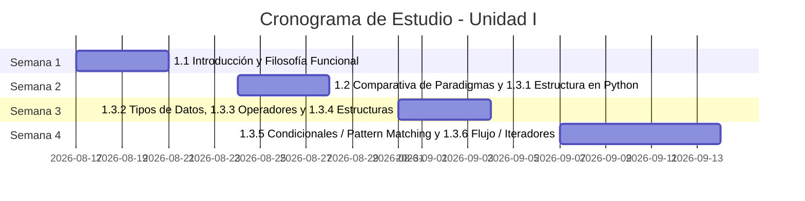

# GUÍA SEMANAL DE ESTUDIO - UNIDAD I
## Fundamentos del Paradigma de Programación Funcional

---

**Programa Educativo:** Ingeniería en Computación Inteligente  
**Materia:** Programación Funcional  
**Facultad:** Facultad de Ingeniería Mecánica y Eléctrica (FIME), Universidad de Colima  
**Período de la Unidad I:** 17 de agosto de 2026 – 14 de septiembre de 2026 (4 Semanas)  
**Carga Horaria:** 5 horas semanales (4 horas con mediación docente + 1 hora de trabajo independiente)  
**Documento Base:** [planeacion-docente.md](file:///c:/Users/bh324/OneDrive/Datos%20adjuntos/Programaci%C3%B2n%20funcional/planeacion-docente.md)

---

## 🎯 Resultado de Aprendizaje de la Unidad I
> **Conocer, aprender y aplicar el paradigma de programación funcional con Python para el uso efectivo del lenguaje mediante buenas prácticas de programación, razonamiento declarativo, inmutabilidad y transparencia referencial.**

---

## 📅 Distribución del Calendario Semanal



| Semana | Período | Temas de la Planeación Docente | Horas (Docente + Indep.) | Entregables / Evidencia |
| :---: | :---: | :--- | :---: | :--- |
| **Semana 1** | 17/08 – 21/08 | **1.1 Introducción a la Programación Funcional**<br>• 1.1.1 ¿Qué es la PF?<br>• 1.1.2 Paradigmas de programación<br>• 1.1.4 Funciones matemáticas<br>• 1.1.5 Cambios de estado e inmutabilidad<br>• 1.1.6 POO vs PF | 4h + 1h = 5h | Bitácora de lectura, Ejercicios 1.1 a 1.3 resueltos |
| **Semana 2** | 24/08 – 28/08 | **1.2 Comparación de Paradigmas con Python**<br>• 1.2.1 Enfoque Estructurado<br>• 1.2.2 Enfoque POO<br>• 1.2.3 Enfoque Funcional<br>**1.3.1 Estructura de programas en Python** | 4h + 1h = 5h | Caso de estudio comparativo multifirma, Ejercicios 2.1 y 2.2 |
| **Semana 3** | 31/08 – 04/09 | **1.3 Conceptos de Python para PF (Parte 1)**<br>• 1.3.2 Tipos de datos (int, float, complex, decimal, bool, str)<br>• 1.3.3 Operadores (aritméticos, lógicos, ternario)<br>• 1.3.4 Estructuras de datos (list, dict, set, tuple) bajo enfoque inmutable | 4h + 1h = 5h | Práctica de laboratorio con estructuras inmutables, Ejercicios 3.1 a 3.3 |
| **Semana 4** | 07/09 – 14/09 | **1.3 Conceptos de Python para PF (Parte 2) e Integración**<br>• 1.3.5 Estructuras condicionales y Pattern Matching (`match...case`)<br>• 1.3.6 Control de flujo (Iterables, Iteradores, `for`, `while`, anidamiento)<br>• Proyecto integrador de Unidad I | 4h + 1h = 5h | Proyecto integrador U1, Ejercicios 4.1 a 4.4, Autoevaluación diagnóstica |

---

# 📚 SEMANA 1: Fundamentos y Filosofía del Paradigma Funcional
**Período:** 17 de agosto al 21 de agosto de 2026  
**Horas:** 4 horas de mediación docente + 1 hora de estudio independiente  

---

### 1. Objetivos de Aprendizaje de la Semana
1. Comprender la definición formal de paradigma de programación y ubicar a la programación funcional en la taxonomía de lenguajes declarativos.
2. Distinguir con precisión matemática entre una función computacional pura y una subrutina imperativa con efectos secundarios.
3. Entender el impacto de los cambios de estado (mutabilidad vs. inmutabilidad) en la concurrencia, depuración y razonamiento formal del software.
4. Comparar conceptual y arquitectónicamente la Programación Orientada a Objetos (POO) frente a la Programación Funcional (PF).

---

### 2. Marco Teórico y Conceptual

```
                  ┌────────────────────────────────────────┐
                  │       PARADIGMAS DE PROGRAMACIÓN       │
                  └───────────────────┬────────────────────┘
                                      │
           ┌──────────────────────────┴──────────────────────────┐
           ▼                                                     ▼
┌──────────────────────────┐                          ┌──────────────────────────┐
│        IMPERATIVO        │                          │       DECLARATIVO        │
├──────────────────────────┤                          ├──────────────────────────┤
│ ¿CÓMO resolverlo?        │                          │ ¿QUÉ resultado obtener?  │
│ Control paso a paso      │                          │ Lógica y relaciones      │
│ Mutación de variables    │                          │ Ausencia de efectos sec. │
├──────────────────────────┤                          ├──────────────────────────┤
│ • Estructurado / Proced. │                          │ • FUNCIONAL (PF)         │
│ • Orientado a Objetos    │                          │ • Lógico (Prolog)        │
└──────────────────────────┘                          └──────────────────────────┘
```

#### 1.1.1 ¿Qué es la Programación Funcional?
La **Programación Funcional (PF)** es un paradigma de desarrollo de software declarativo donde el cómputo se concibe como la **evaluación de funciones matemáticas** y se evita a toda costa el estado mutable y la mutación de datos. En PF, las funciones son "ciudadanos de primera clase" (*First-Class Citizens*), lo que significa que pueden ser asignadas a variables, pasadas como argumentos y retornadas desde otras funciones.

#### 1.1.2 Paradigma de Programación
Un paradigma es un conjunto de patrones, conceptos y filosofías que estructuran el pensamiento del desarrollador para formular soluciones computacionales:
*   **Enfoque Imperativo:** Centrado en *cómo* lograr el resultado mediante una secuencia de instrucciones que modifican el estado de la memoria global o local.
*   **Enfoque Declarativo:** Centrado en *qué* se desea calcular, describiendo transformaciones y relaciones matemáticas sobre los datos sin especificar la mecánica explícita de registros o índices.

#### 1.1.4 Funciones Matemáticas vs. Subrutinas
En matemáticas, una función $f: A \to B$ es una correspondencia unívoca que asocia a cada elemento del dominio $A$ exactamente un elemento del codominio $B$.
*   **Transparencia Referencial:** Una expresión es referencialmente transparente si puede ser reemplazada por su valor sin alterar el comportamiento del programa. Por ejemplo, en $f(x) = x^2$, si $x = 4$, $f(4)$ siempre puede sustituirse por $16$.
*   **Función Pura:** Cumple dos condiciones inquebrantables:
    1.  Para los mismos argumentos de entrada, **siempre** devuelve exactamente el mismo valor de salida (determinismo).
    2.  No produce **efectos secundarios** (*side effects*).

#### 1.1.5 Cambios de Estado y Efectos Secundarios (*Side Effects*)
Un efecto secundario ocurre cuando una función modifica el entorno fuera de su ámbito local:
*   Alterar variables globales o parámetros recibidos por referencia.
*   Modificar estructuras de datos *in-place* (mutar listas, diccionarios).
*   Realizar operaciones de I/O (escribir en disco, imprimir en consola, consultar la red o la hora del sistema).

```
Función Impura:  Entrada ───► [ f(x) + Modifica Estado Global / I/O ] ───► Salida impredecible
Función Pura:    Entrada ───► [ f(x) (Sin estado, Determinista)     ] ───► Salida idéntica
```

#### 1.1.6 POO vs. Programación Funcional

| Característica | Programación Orientada a Objetos (POO) | Programación Funcional (PF) |
| :--- | :--- | :--- |
| **Unidad básica** | Objetos (Clases) que encapsulan datos y métodos. | Funciones puras y tipos de datos inmutables. |
| **Manejo del estado** | Estado mutable encapsulado en atributos internos (`self.attr`). | Inmutabilidad: los datos no cambian, se transforman en nuevos datos. |
| **Flujo de control** | Bucles imperativos (`for`, `while`), llamadas a métodos. | Recursión, composición de funciones, funciones de alto orden. |
| **Efectos secundarios** | Habituales y esperados al modificar el estado del objeto. | Aislados o eliminados; se favorece la transparencia referencial. |
| **Concurrencia** | Compleja debido a condiciones de carrera por memoria compartida. | Natural y segura: sin estado mutable no hay condiciones de carrera. |

---

### 3. Ejercicios Resueltos Paso a Paso (Semana 1)

#### 📝 Ejercicio 1.1: Refactorización de Función Impura a Función Pura
**Contexto del Problema:**  
En un sistema de facturación, se requiere calcular el total con impuestos y descuentos. El código inicial utiliza variables globales y altera el estado de la memoria.

**Código Inicial (Impuro con efectos secundarios):**
```python
# CÓDIGO IMPURO (NO FUNCIONAL)
tasa_iva = 0.16
total_acumulado = 0.0

def agregar_producto_impuro(precio: float, descuento: float):
    global total_acumulado  # Modifica estado externo
    descuento_aplicado = precio * descuento
    precio_final = (precio - descuento_aplicado) * (1 + tasa_iva)
    total_acumulado += precio_final  # Efecto secundario
    return precio_final
```

**Solución Funcional Paso a Paso:**

*   **Paso 1 (Análisis de Pureza):**
    *   *Falla 1:* Dependencia de `tasa_iva` global (si cambia externamente, la función cambia de comportamiento sin cambiar sus argumentos).
    *   *Falla 2:* Mutación de `total_acumulado` (efecto secundario acumulativo).
*   **Paso 2 (Diseño Matemático):**
    Definimos la función pura $f(p, d, i) = (p \cdot (1 - d)) \cdot (1 + i)$, donde todos los parámetros son explícitos e inmutables.
*   **Paso 3 (Implementación en Python):**

```python
from typing import NamedTuple

class Producto(NamedTuple):
    nombre: str
    precio: float
    descuento: float

def calcular_precio_neto(precio: float, descuento: float, tasa_iva: float = 0.16) -> float:
    """Calcula el precio final con IVA y descuento de forma PURA.
    
    No modifica variables globales ni genera efectos secundarios.
    """
    precio_con_descuento = precio * (1.0 - descuento)
    return round(precio_con_descuento * (1.0 + tasa_iva), 2)

def acumular_totales(precios: tuple[float, ...]) -> float:
    """Suma inmutable de una colección de precios."""
    return round(sum(precios), 2)

# Demostración de Transparencia Referencial
if __name__ == "__main__":
    prod1 = Producto(nombre="Monitor 4K", precio=8000.0, descuento=0.10)
    
    # Invocación 1 y 2 con mismos argumentos producen idéntico resultado
    res1 = calcular_precio_neto(prod1.precio, prod1.descuento, 0.16)
    res2 = calcular_precio_neto(prod1.precio, prod1.descuento, 0.16)
    
    print(f"Llamada 1: ${res1}")
    print(f"Llamada 2: ${res2}")
    print(f"¿Transparencia Referencial lograda?: {res1 == res2 == 8352.0}")
```

*   **Salida del Programa:**
```text
Llamada 1: $8352.0
Llamada 2: $8352.0
¿Transparencia Referencial lograda?: True
```

---

#### 📝 Ejercicio 1.2: Modelado Matemático y Composición de Funciones Puras
**Contexto del Problema:**  
Se requiere normalizar un vector de datos para un modelo de inteligencia artificial:
1. Limpiar valores nulos o negativos reemplazándolos por cero: $f(x) = \max(0, x)$.
2. Aplicar escala logarítmica para reducir varianza: $g(x) = \ln(x + 1)$.
3. Estandarizar multiplicando por un factor de escala $\alpha = 100$: $h(x) = x \cdot \alpha$.

**Solución Funcional Paso a Paso:**

*   **Paso 1 (Descomposición en funciones puras atómicas):**
    *   $f: \mathbb{R} \to \mathbb{R}^+$
    *   $g: \mathbb{R}^+ \to \mathbb{R}^+$
    *   $h: \mathbb{R}^+ \to \mathbb{R}^+$
*   **Paso 2 (Composición matemática):**
    La transformación total es el pipeline $(h \circ g \circ f)(x) = h(g(f(x)))$.
*   **Paso 3 (Implementación en Python):**

```python
import math
from typing import Callable

# 1. Definición de funciones puras atómicas
def rectificar_cero(x: float) -> float:
    return max(0.0, float(x))

def escala_logaritmica(x: float) -> float:
    return math.log(x + 1.0)

def escalar_por_factor(factor: float) -> Callable[[float], float]:
    """Generador de funciones (High-Order Function) puras."""
    return lambda x: x * factor

# 2. Función de composición pura
def pipeline_transformacion(x: float) -> float:
    escalar_100 = escalar_por_factor(100.0)
    # Composición explícita: h(g(f(x)))
    paso1 = rectificar_cero(x)
    paso2 = escala_logaritmica(paso1)
    paso3 = escalar_100(paso2)
    return round(paso3, 4)

# 3. Aplicación a un lote inmutable de datos
if __name__ == "__main__":
    datos_crudos: tuple[float, ...] = (-10.5, 0.0, 5.0, 20.0, 100.0)
    
    # Transformación sin modificar la tupla original
    datos_normalizados = tuple(pipeline_transformacion(x) for x in datos_crudos)
    
    print(f"Datos originales (inmutables): {datos_crudos}")
    print(f"Datos normalizados:            {datos_normalizados}")
```

*   **Salida del Programa:**
```text
Datos originales (inmutables): (-10.5, 0.0, 5.0, 20.0, 100.0)
Datos normalizados:            (0.0, 0.0, 179.1759, 304.4522, 461.5121)
```

---

#### 📝 Ejercicio 1.3: Modelado de Estado Inmutable vs. Mutable (Cuenta Bancaria)
**Contexto del Problema:**  
Diseñar un modelo para gestionar transacciones bancarias (depósitos y retiros).
*   Enfoque POO tradicional: Modifica el atributo `balance` dentro del objeto.
*   Enfoque Funcional: El estado es un historial inmutable de transacciones; el saldo actual es el resultado de reducir (*reduce*) el historial.

```python
from typing import NamedTuple
from enum import Enum

class TipoTransaccion(Enum):
    DEPOSITO = "DEPOSITO"
    RETIRO = "RETIRO"

class Transaccion(NamedTuple):
    id_tx: int
    tipo: TipoTransaccion
    monto: float

class CuentaBancariaInmutable(NamedTuple):
    numero_cuenta: str
    titular: str
    historial: tuple[Transaccion, ...]

# Operación Pura: Retorna una NUEVA cuenta con el historial actualizado
def registrar_transaccion(cuenta: CuentaBancariaInmutable, tx: Transaccion) -> CuentaBancariaInmutable:
    nuevo_historial = cuenta.historial + (tx,)  # Concatenación inmutable
    return CuentaBancariaInmutable(
        numero_cuenta=cuenta.numero_cuenta,
        titular=cuenta.titular,
        historial=nuevo_historial
    )

# Función Pura: Calcula el balance a partir del historial sin mutar nada
def calcular_balance(cuenta: CuentaBancariaInmutable) -> float:
    balance = 0.0
    for tx in cuenta.historial:
        if tx.tipo == TipoTransaccion.DEPOSITO:
            balance += tx.monto
        elif tx.tipo == TipoTransaccion.RETIRO:
            balance -= tx.monto
    return round(balance, 2)

if __name__ == "__main__":
    cuenta_v0 = CuentaBancariaInmutable(
        numero_cuenta="0123456789",
        titular="Walter Alexander",
        historial=()
    )
    
    # Realizar operaciones creando nuevos estados
    tx1 = Transaccion(1, TipoTransaccion.DEPOSITO, 1500.0)
    tx2 = Transaccion(2, TipoTransaccion.DEPOSITO, 500.0)
    tx3 = Transaccion(3, TipoTransaccion.RETIRO, 350.0)
    
    cuenta_v1 = registrar_transaccion(cuenta_v0, tx1)
    cuenta_v2 = registrar_transaccion(cuenta_v1, tx2)
    cuenta_v3 = registrar_transaccion(cuenta_v2, tx3)
    
    print(f"Estado inicial -> Saldo: ${calcular_balance(cuenta_v0)} (Transacciones: {len(cuenta_v0.historial)})")
    print(f"Estado tras tx1 -> Saldo: ${calcular_balance(cuenta_v1)} (Transacciones: {len(cuenta_v1.historial)})")
    print(f"Estado tras tx2 -> Saldo: ${calcular_balance(cuenta_v2)} (Transacciones: {len(cuenta_v2.historial)})")
    print(f"Estado final (v3)-> Saldo: ${calcular_balance(cuenta_v3)} (Transacciones: {len(cuenta_v3.historial)})")
```

---

### 4. Retos y Autoevaluación (Semana 1)
1. **Pregunta Teórica:** ¿Por qué una función que genera números pseudoaleatorios con `random.random()` no se considera una función pura? Justifique con base en la transparencia referencial.
2. **Reto Práctico:** Escriba una función pura `calcular_desviacion_media(valores: tuple[float, ...]) -> float` que no modifique la tupla de entrada y calcule la desviación media absoluta de un conjunto de datos.

---

# 📚 SEMANA 2: Comparación Práctica de Paradigmas con Python
**Período:** 24 de agosto al 28 de agosto de 2026  
**Horas:** 4 horas de mediación docente + 1 hora de estudio independiente  

---

### 1. Objetivos de Aprendizaje de la Semana
1. Contrastar de manera tangible el mismo problema resuelto mediante Programación Estructurada, Programación Orientada a Objetos y Programación Funcional en Python.
2. Reconocer las ventajas y desventajas de cada paradigma en términos de legibilidad, acoplamiento, mutabilidad y facilidad de prueba.
3. Comprender la estructura estándar y modular de un programa en Python funcional (`Type Hints`, alias de tipos, validación pura, bloque `__main__`).

---

### 2. Marco Teórico y Conceptual

#### 1.2 Comparación de Paradigmas con Python

```
                                    PROBLEMA: PROCESAR LISTA DE DATOS
                                                   │
        ┌──────────────────────────────────────────┼────────────────────────────────────────┐
        ▼                                          ▼                                        ▼
┌───────────────────────────────┐  ┌───────────────────────────────┐  ┌───────────────────────────────┐
│         ESTRUCTURADO          │  │     ORIENTADO A OBJETOS       │  │          FUNCIONAL            │
├───────────────────────────────┤  ├───────────────────────────────┤  ├───────────────────────────────┤
│ • Variables y bucles globales │  │ • Clases y métodos            │  │ • Funciones puras             │
│ • Control de flujo paso a paso│  │ • Atributos mutables (`self`) │  │ • Inmutabilidad de datos      │
│ • Mutación de arreglos        │  │ • Ocultamiento de estado      │  │ • Transformación por pipeline │
└───────────────────────────────┘  └───────────────────────────────┘  └───────────────────────────────┘
```

*   **1.2.1 Programación Estructurada:** Se basa en la ejecución secuencial, estructuras de selección (`if/else`) y de repetición (`for/while`). Tiende a utilizar variables auxiliares mutables (acumuladores, banderas) y mutación directa de arreglos.
*   **1.2.2 Programación Orientada a Objetos (POO):** Modela el dominio mediante objetos que contienen estado interno mutable y métodos para interactuar con dicho estado. Si bien ofrece buen encapsulamiento, la mutabilidad interna puede complicar el rastreo de errores en sistemas distribuidos o concurrentes.
*   **1.2.3 Programación Funcional (PF):** Modela el dominio como flujos de datos que atraviesan transformadores puros. No hay clases con estado mutable, sino estructuras de datos de solo lectura y funciones componibles.

#### 1.3.1 Estructura Estándar de los Programas en Python Funcional
Para aplicar el paradigma funcional en Python con calidad profesional (PEP 8 y PEP 484):
1.  **Encabezado e Importaciones:** Módulos de tipado (`typing`, `dataclasses`, `collections.abc`).
2.  **Definición de Tipos Inmutables:** `NamedTuple`, `dataclass(frozen=True)` o alias de tipos (`TypeAlias`).
3.  **Funciones Puras de Dominio:** Con anotaciones de tipos completas y *docstrings*.
4.  **Composición y Pipelines:** Funciones que coordinan el flujo de transformación de datos.
5.  **Punto de Entrada Aislado:** `if __name__ == "__main__":` encargado del I/O (lectura, impresión).

---

### 3. Ejercicios Resueltos Paso a Paso (Semana 2)

#### 📝 Ejercicio 2.1: Caso de Estudio Comparativo Integral — Análisis de Calificaciones
**Problema:**  
Dado un conjunto de calificaciones numéricas de estudiantes (de 0 a 100), se requiere:
1. Filtrar las calificaciones reprobatorias ($< 60$).
2. Aplicar una curva de ajuste del $5\%$ sobre la calificación original solo a los aprobados.
3. Calcular el promedio final del grupo ajustado.

---

##### Solución A: Enfoque Estructurado / Procedimental
```python
# ENFOQUE 1: ESTRUCTURADO (Variables mutables y control de índices)
calificaciones = [45, 78, 90, 55, 88, 62, 30, 95]

# Mutación de acumuladores y estructuras
aprobados_ajustados = []
suma_total = 0.0

for i in range(len(calificaciones)):
    calif = calificaciones[i]
    if calif >= 60:
        ajuste = calif * 1.05
        if ajuste > 100:
            ajuste = 100.0
        aprobados_ajustados.append(ajuste)  # Mutación in-place

for calif in aprobados_ajustados:
    suma_total += calif

promedio_estructurado = suma_total / len(aprobados_ajustados)
print(f"[Estructurado] Promedio: {promedio_estructurado:.2f}")
```

---

##### Solución B: Enfoque Orientado a Objetos (POO)
```python
# ENFOQUE 2: ORIENTADO A OBJETOS (Estado mutable encapsulado en clase)
class GestorCalificaciones:
    def __init__(self, calificaciones: list[float]):
        self._calificaciones = list(calificaciones)  # Estado interno
        self._procesadas: list[float] = []

    def filtrar_y_ajustar(self) -> None:
        self._procesadas.clear()
        for c in self._calificaciones:
            if c >= 60.0:
                ajuste = min(100.0, c * 1.05)
                self._procesadas.append(ajuste)  # Mutación del objeto

    def obtener_promedio(self) -> float:
        if not self._procesadas:
            return 0.0
        return sum(self._procesadas) / len(self._procesadas)

gestor = GestorCalificaciones([45, 78, 90, 55, 88, 62, 30, 95])
gestor.filtrar_y_ajustar()
print(f"[POO] Promedio: {gestor.obtener_promedio():.2f}")
```

---

##### Solución C: Enfoque Funcional (Python Moderno, Inmutable y Puro)
```python
# ENFOQUE 3: FUNCIONAL (Funciones puras, datos inmutables y sin efectos secundarios)
from typing import Final

# 1. Funciones puras atómicas
def es_aprobatorio(calificacion: float) -> bool:
    """Predicado puro: evalúa condición."""
    return calificacion >= 60.0

def aplicar_curva(calificacion: float, porcentaje: float = 0.05) -> float:
    """Transformación pura: calcula ajuste acotado a 100."""
    return min(100.0, round(calificacion * (1.0 + porcentaje), 2))

def calcular_promedio(valores: tuple[float, ...]) -> float:
    """Cálculo puro: no muta la colección."""
    return round(sum(valores) / len(valores), 2) if valores else 0.0

# 2. Pipeline de transformación funcional
def procesar_calificaciones(datos: tuple[float, ...]) -> tuple[float, float]:
    """Pipeline puro: retorna (promedio, tupla_calificaciones_ajustadas)."""
    # Filtrar -> Transformar -> Calcular
    aprobados = tuple(c for c in datos if es_aprobatorio(c))
    ajustados = tuple(aplicar_curva(c) for c in aprobados)
    promedio = calcular_promedio(ajustados)
    return promedio, ajustados

# 3. Punto de entrada
if __name__ == "__main__":
    CALIFICACIONES_ORIGINALES: Final[tuple[float, ...]] = (45.0, 78.0, 90.0, 55.0, 88.0, 62.0, 30.0, 95.0)
    
    promedio_funcional, lista_final = procesar_calificaciones(CALIFICACIONES_ORIGINALES)
    
    print(f"[Funcional] Calificaciones originales: {CALIFICACIONES_ORIGINALES}")
    print(f"[Funcional] Calificaciones ajustadas:   {lista_final}")
    print(f"[Funcional] Promedio Final del Grupo:  {promedio_funcional:.2f}")
```

*   **Tabla Comparativa de la Solución:**

| Criterio | Estructurado | Orientado a Objetos | Funcional |
| :--- | :--- | :--- | :--- |
| **Mutabilidad de datos** | Alta (listas modificadas en bucles) | Media/Alta (`self._procesadas`) | Nula (solo Tuplas inmutables) |
| **Reutilización** | Baja (código dependiente del contexto) | Media (requiere instanciar clase) | Alta (funciones puras desacopladas) |
| **Facilidad de prueba unitaria** | Regular (requiere preparar estado) | Media (requiere ciclo de vida) | Máxima (solo pasar entradas y comparar salida) |

---

#### 📝 Ejercicio 2.2: Organización de un Módulo Funcional con Tipado Estricto
**Contexto del Problema:**  
Diseñar un módulo para el cálculo de nómina salarial con deducciones fiscales y bonificaciones por productividad, estructurado conforme a las mejores prácticas de Python.

```python
"""Módulo de Cálculo de Nómina Funcional
Facultad de Ingeniería Mecánica y Eléctrica - ICI
"""
from typing import NamedTuple, Final

# 1. Modelado de datos inmutables
class Empleado(NamedTuple):
    id_emp: str
    nombre: str
    salario_base: float
    horas_extra: int
    es_sindicalizado: bool

class ReciboNomina(NamedTuple):
    id_emp: str
    nombre: str
    salario_bruto: float
    deduccion_fiscal: float
    pago_neto: float

# Constantes inmutables de configuración
TASA_ISR: Final[float] = 0.12
VALOR_HORA_EXTRA: Final[float] = 150.0
CUOTA_SINDICAL: Final[float] = 200.0

# 2. Funciones de cálculo puras
def calcular_pago_horas_extra(horas: int, tarifa: float = VALOR_HORA_EXTRA) -> float:
    return float(max(0, horas) * tarifa)

def calcular_deducciones(salario_bruto: float, es_sindicalizado: bool) -> float:
    isr = salario_bruto * TASA_ISR
    sindicato = CUOTA_SINDICAL if es_sindicalizado else 0.0
    return round(isr + sindicato, 2)

def generar_recibo(emp: Empleado) -> ReciboNomina:
    pago_extra = calcular_pago_horas_extra(emp.horas_extra)
    salario_bruto = round(emp.salario_base + pago_extra, 2)
    deducciones = calcular_deducciones(salario_bruto, emp.es_sindicalizado)
    pago_neto = round(salario_bruto - deducciones, 2)
    
    return ReciboNomina(
        id_emp=emp.id_emp,
        nombre=emp.nombre,
        salario_bruto=salario_bruto,
        deduccion_fiscal=deducciones,
        pago_neto=pago_neto
    )

def procesar_plantilla(empleados: tuple[Empleado, ...]) -> tuple[ReciboNomina, ...]:
    """Mapeo puro de empleados a recibos de nómina."""
    return tuple(generar_recibo(emp) for emp in empleados)

# 3. Demostración y Ejecución
if __name__ == "__main__":
    plantilla: tuple[Empleado, ...] = (
        Empleado("E01", "Ana Gómez", 12000.0, 5, True),
        Empleado("E02", "Carlos Ruiz", 15000.0, 0, False),
        Empleado("E03", "Diana Soto", 18000.0, 10, True),
    )
    
    recibos = procesar_plantilla(plantilla)
    for r in recibos:
        print(f"Recibo: {r.nombre:<12} | Bruto: ${r.salario_bruto:>8.2f} | Deducciones: ${r.deduccion_fiscal:>7.2f} | Neto: ${r.pago_neto:>8.2f}")
```

*   **Salida del Programa:**
```text
Recibo: Ana Gómez    | Bruto: $12750.00 | Deducciones: $1730.00 | Neto: $11020.00
Recibo: Carlos Ruiz  | Bruto: $15000.00 | Deducciones: $1800.00 | Neto: $13200.00
Recibo: Diana Soto   | Bruto: $19500.00 | Deducciones: $2540.00 | Neto: $16960.00
```

---

# 📚 SEMANA 3: Sistema de Tipos, Operadores y Estructuras de Datos
**Período:** 31 de agosto al 04 de septiembre de 2026  
**Horas:** 4 horas de mediación docente + 1 hora de estudio independiente  

---

### 1. Objetivos de Aprendizaje de la Semana
1. Dominar los tipos de datos numéricos (`int`, `float`, `complex`, `decimal.Decimal`), lógicos (`bool`) y cadenas (`str`) en Python, reconociendo su naturaleza inmutable.
2. Utilizar operadores aritméticos, lógicos y expresiones condicionales (operador ternario) para construir código basado en evaluación de expresiones en lugar de sentencias.
3. Manejar estructuras de datos (`list`, `dict`, `set`, `tuple`, `frozenset`) desde la perspectiva de la inmutabilidad y la no mutación *in-place*.

---

### 2. Marco Teórico y Conceptual

#### 1.3.2 Tipos de Datos y su Mutabilidad en Python
En Python, todos los datos son objetos en memoria con un identificador único, un tipo y un valor.

```
┌────────────────────────────────────────────────────────────────────────┐
│                        CLASIFICACIÓN DE TIPOS EN PYTHON                │
├───────────────────────────────────┬────────────────────────────────────┤
│         TIPOS INMUTABLES          │           TIPOS MUTABLES           │
│   (Seguros para Prog. Funcional)  │   (Evitar mutación directa)        │
├───────────────────────────────────┼────────────────────────────────────┤
│ • int, float, complex             │ • list                             │
│ • decimal.Decimal                 │ • dict                             │
│ • bool                            │ • set                              │
│ • str                             │ • bytearray                        │
│ • tuple                           │                                    │
│ • frozenset                       │                                    │
└───────────────────────────────────┴────────────────────────────────────┘
```

*   **1.3.2.1 Numéricos:**
    *   `int`: Enteros de precisión arbitraria.
    *   `float`: Número de punto flotante IEEE 754 de 64 bits.
    *   `complex`: Números complejos con parte real e imaginaria ($a + bj$).
    *   `decimal.Decimal`: Aritmética decimal de precisión fija y exacta (indispensable para cálculos financieros donde el redondeo binario de `float` genera pérdidas de precisión).
    *   Notación Científica: Ejemplo `1.5e-4` ($1.5 \times 10^{-4}$).
*   **1.3.2.2 Lógicos (`bool`):**
    *   `True` y `False`. Soportan evaluación de cortocircuito en operaciones booleanas (`and`, `or`).
*   **1.3.2.3 Cadenas (`str`):**
    *   Secuencias inmutables de caracteres Unicode. Cualquier operación de manipulación (`replace`, `upper`, concatenación) devuelve un nuevo `str`.

#### 1.3.3 Operadores y Expresiones vs. Sentencias
*   **Sentencia (*Statement*):** Una instrucción que realiza una acción pero no produce un valor directo (ej. `x = 5`, `if x > 0: pass`).
*   **Expresión (*Expression*):** Una combinación de valores, funciones y operadores que siempre se **evalúa y retorna un valor** (ej. `x + 2`, `math.sqrt(9)`).
*   **Operador Ternario (Expresión Condicional):**  
    `valor_si_verdadero if condicion else valor_si_falso`  
    Permite evaluar decisiones dentro de expresiones puras sin recurrir a bloques de sentencias `if-else`.

#### 1.3.4 Estructuras de Datos bajo Enfoque Inmutable
1.  **Tuplas (`tuple`):** Colección ordenada inmutable. Es el contenedor primordial en programación funcional en Python.
2.  **Conjuntos Inmutables (`frozenset`):** Colección no ordenada de elementos únicos que no puede ser alterada tras su creación.
3.  **Diccionarios Inmutables:** Uso de desempaquetado `{**d1, **d2}` para generar nuevos diccionarios sin mutar los originales, o `types.MappingProxyType` para vistas de solo lectura.
4.  **Listas (`list`):** Aunque son mutables, en PF se manipulan creando nuevas listas mediante comprensiones (`[x for x in lista]`) o convirtiéndolas a `tuple`.

---

### 3. Ejercicios Resueltos Paso a Paso (Semana 3)

#### 📝 Ejercicio 3.1: Precisión Numérica Exacta con `Decimal` y `Complex`
**Contexto del Problema:**  
Un sistema de microtransacciones bursátiles calcula el valor presente neto de una cartera de inversión y el análisis de impedancia eléctrica de un circuito inteligente.
1. Demostrar la discrepancia entre `float` binario y `Decimal`.
2. Calcular la impedancia total en serie de dos circuitos con números complejos de forma pura.

```python
from decimal import Decimal, getcontext
import cmath

# Ajuste de precisión a 10 dígitos significativos
getcontext().prec = 10

# 1. Demostración de Precisión: Float vs Decimal
def calcular_interes_float(monto: float, tasa: float, periodos: int) -> float:
    # Pérdida de precisión binaria acumulativa
    total = monto
    for _ in range(periodos):
        total += total * tasa
    return total

def calcular_interes_decimal(monto: Decimal, tasa: Decimal, periodos: int) -> Decimal:
    """Cálculo financiero puro y de alta precisión."""
    factor = (Decimal("1.0") + tasa) ** periodos
    return (monto * factor).quantize(Decimal("0.01"))

# 2. Operaciones con Números Complejos (Impedancia Z = R + jX)
def calcular_impedancia_equivalente_serie(z1: complex, z2: complex) -> complex:
    """Suma pura de números complejos."""
    return z1 + z2

def calcular_magnitud_y_fase(z: complex) -> tuple[float, float]:
    """Retorna magnitud y ángulo de fase en grados."""
    magnitud = abs(z)
    fase_grados = cmath.phase(z) * (180.0 / cmath.pi)
    return round(magnitud, 3), round(fase_grados, 3)

if __name__ == "__main__":
    # Prueba financiera
    capital_f = 1000.0
    capital_d = Decimal("1000.00")
    tasa_f = 0.0001
    tasa_d = Decimal("0.0001")
    
    print(f"Resultado con float:   ${calcular_interes_float(capital_f, tasa_f, 1000):.6f}")
    print(f"Resultado con Decimal: ${calcular_interes_decimal(capital_d, tasa_d, 1000)}")
    
    # Prueba de números complejos
    z_resistor = complex(50, 0)      # 50 Ohms reales
    z_inductor = complex(0, 37.7)    # 37.7 Ohms reactivos inductivos
    
    z_total = calcular_impedancia_equivalente_serie(z_resistor, z_inductor)
    mag, fase = calcular_magnitud_y_fase(z_total)
    
    print(f"\nImpedancia Total Z: {z_total}")
    print(f"Magnitud: {mag} Ohms | Fase: {fase}°")
```

---

#### 📝 Ejercicio 3.2: Transformación Inmutable de Diccionarios y Tuplas
**Contexto del Problema:**  
Se tiene un catálogo de productos representado como un diccionario inmutable. Se requiere actualizar los precios aplicando un descuento del $15\%$ solo a los productos de la categoría `"Electrónica"`, sin modificar el diccionario original.

```python
from typing import NamedTuple
from types import MappingProxyType

class Item(NamedTuple):
    nombre: str
    categoria: str
    precio: float

# Catálogo original inmutable
CATALOGO_INICIAL: dict[str, Item] = {
    "P01": Item("Teclado Mecánico", "Electrónica", 1500.0),
    "P02": Item("Silla Ergonómica", "Mobiliario", 4500.0),
    "P03": Item("Mouse Inalámbrico", "Electrónica", 800.0),
    "P04": Item("Cuaderno Profesional", "Papelería", 95.0),
}

# Función Pura de Transformación
def aplicar_descuento_categoria(
    catalogo: dict[str, Item], 
    categoria_objetivo: str, 
    descuento: float = 0.15
) -> dict[str, Item]:
    """Crea y retorna un nuevo diccionario con los precios actualizados.
    
    Utiliza expresiones condicionales (operador ternario) y no muta el catálogo inicial.
    """
    nuevo_catalogo: dict[str, Item] = {
        codigo: (
            Item(item.nombre, item.categoria, round(item.precio * (1.0 - descuento), 2))
            if item.categoria == categoria_objetivo
            else item
        )
        for codigo, item in catalogo.items()
    }
    return nuevo_catalogo

if __name__ == "__main__":
    catalogo_actualizado = aplicar_descuento_categoria(CATALOGO_INICIAL, "Electrónica", 0.15)
    
    print("--- CATÁLOGO ORIGINAL (SIN MODIFICAR) ---")
    for k, v in CATALOGO_INICIAL.items():
        print(f"[{k}] {v.nombre:<20} | ${v.precio}")
        
    print("\n--- NUEVO CATÁLOGO CON DESCUENTO APLICADO ---")
    for k, v in catalogo_actualizado.items():
        print(f"[{k}] {v.nombre:<20} | ${v.precio}")
```

---

#### 📝 Ejercicio 3.3: Álgebra de Conjuntos Inmutables con `frozenset`
**Contexto del Problema:**  
Determinar el perfil de competencias de estudiantes de Ingeniería en Computación Inteligente:
1. Conjunto $A$: Estudiantes con acreditación en Python.
2. Conjunto $B$: Estudiantes con acreditación en Matemáticas Discretas.
3. Encontrar estudiantes elegibles para la materia (intersección $A \cap B$) y los que requieren regularización en alguna de ellas.

```python
from typing import Final

# Datos de entrada inmutables
GRUPO_PYTHON: Final[frozenset[str]] = frozenset({"Alex", "Beatriz", "Carlos", "Diana", "Eduardo"})
GRUPO_DISCRETAS: Final[frozenset[str]] = frozenset({"Beatriz", "Diana", "Eduardo", "Fernanda", "Gabriel"})

# Funciones Puras de Álgebra de Conjuntos
def obtener_elegibles(aprobados_py: frozenset[str], aprobados_mat: frozenset[str]) -> frozenset[str]:
    """Intersección pura: A ∩ B"""
    return aprobados_py & aprobados_mat

def obtener_pendientes_matematicas(aprobados_py: frozenset[str], aprobados_mat: frozenset[str]) -> frozenset[str]:
    """Diferencia pura: A - B (Aprobaron Python pero no Discretas)"""
    return aprobados_py - aprobados_mat

def obtener_universo_completo(aprobados_py: frozenset[str], aprobados_mat: frozenset[str]) -> frozenset[str]:
    """Unión pura: A ∪ B"""
    return aprobados_py | aprobados_mat

if __name__ == "__main__":
    elegibles = obtener_elegibles(GRUPO_PYTHON, GRUPO_DISCRETAS)
    pendientes_mat = obtener_pendientes_matematicas(GRUPO_PYTHON, GRUPO_DISCRETAS)
    todos = obtener_universo_completo(GRUPO_PYTHON, GRUPO_DISCRETAS)
    
    print(f"Total estudiantes registrados: {len(todos)}")
    print(f"Estudiantes elegibles (A ∩ B): {sorted(tuple(elegibles))}")
    print(f"Pendientes de Matemáticas:     {sorted(tuple(pendientes_mat))}")
```

---

# 📚 SEMANA 4: Control de Flujo Funcional, Pattern Matching e Iteración
**Período:** 07 de septiembre al 14 de septiembre de 2026  
**Horas:** 4 horas de mediación docente + 1 hora de estudio independiente  

---

### 1. Objetivos de Aprendizaje de la Semana
1. Comprender la evolución de las estructuras condicionales tradicionales (`if`, `if-else`, `if-elif-else`) hacia el **Concordancia de Patrones Estructurado (*Structural Pattern Matching* - `match ... case`)** en Python 3.10+.
2. Dominar el **Protocolo de Iteración** en Python (`iter()`, `next()`, `StopIteration`) entendiendo la diferencia entre iterables e iteradores.
3. Analizar la transición de bucles imperativos con mutación de índices (`for i in range`, `while`, `break`, `continue`) hacia comprensiones declarativas y evaluación perezosa.
4. Desarrollar un proyecto integrador de la Unidad I que consolide todo lo aprendido.

---

### 2. Marco Teórico y Conceptual

#### 1.3.5 Concordancia de Patrones Estructurado (*Structural Pattern Matching*)
Introducido en Python 3.10 (PEP 634), `match ... case` es una de las características más representativas de los lenguajes funcionales modernos (Haskell, OCaml, Scala, Rust):
*   **Desestructuración:** Extrae simultáneamente datos anidados de tuplas, listas o diccionarios.
*   **Guardas condicionales (`if`):** Permiten evaluar condiciones adicionales dentro del patrón.
*   **Comprobación exhaustiva:** Garantiza el manejo seguro de todos los tipos y formatos esperados.

```python
# Sintaxis Conceptual de Structural Pattern Matching
match comando:
    case ("MOVER", int(x), int(y)) if x >= 0 and y >= 0:
        ... # Desestructuración con guarda
    case {"tipo": "LOGIN", "usuario": str(u)}:
        ... # Coincidencia de mapeo / diccionario
    case _:
        ... # Caso por defecto (Wildcard)
```

#### 1.3.6 Iterables, Iteradores y Flujo de Datos Funcional
*   **Iterable:** Cualquier objeto capaz de retornar sus elementos uno a uno (implementa `__iter__()`). Ejemplos: `list`, `tuple`, `str`, `dict`, `range`.
*   **Iterador:** Objeto con estado que representa una secuencia de datos y produce el siguiente elemento al invocar `next()` (implementa `__next__()`).
*   **Diferencia Fundamental:**
    *   Un iterable puede recorrerse múltiples veces.
    *   Un iterador es consumible: una vez agotado lanza `StopIteration`.
*   **De Bucles a Expresiones:** En programación funcional pura, se evitan las sentencias `break` y `continue` debido a que generan saltos de control imperativos e introducen efectos secundarios en variables centinela. Se sustituyen por filtros, cortes declarativos y comprensiones puras.

---

### 3. Ejercicios Resueltos Paso a Paso (Semana 4)

#### 📝 Ejercicio 4.1: Despacho de Comandos con Structural Pattern Matching
**Contexto del Problema:**  
Un procesador de mensajes para un dron autónomo recibe instrucciones en diferentes formatos (tuplas de coordenadas, diccionarios de sensores o códigos de emergencia en cadena). Se requiere procesar cada mensaje de forma pura.

```python
from typing import Any

def procesar_comando_dron(comando: Any) -> str:
    """Procesador puro de comandos utilizando Structural Pattern Matching (Python 3.10+)."""
    match comando:
        # 1. Coincidencia de patrón de tupla: ("DESPEGAR", altitud)
        case ("DESPEGAR", float(alt) | int(alt)) if alt > 0:
            return f"Iniciando despegue controlado hacia altitud: {float(alt):.1f}m"
            
        # 2. Coincidencia de tupla con 3 coordenadas: ("MOVER", x, y, z)
        case ("MOVER", (int(x) | float(x)), (int(y) | float(y)), (int(z) | float(z))):
            return f"Trayectoria fijada hacia coordenadas vectoriales: ({x}, {y}, {z})"
            
        # 3. Coincidencia de diccionario con sensor: {"sensor": "BATERIA", "nivel": n}
        case {"sensor": "BATERIA", "nivel": int(n)} if n < 15:
            return f"ALERTA CRÍTICA: Batería baja ({n}%). Retornando a base de inmediato."
            
        case {"sensor": "BATERIA", "nivel": int(n)}:
            return f"Estado de batería nominal: {n}%"
            
        # 4. Cadena simple de emergencia
        case "EMERGENCIA_PARO":
            return "ORDEN DE PARO DE EMERGENCIA EJECUTADA: Motores apagados."
            
        # 5. Patrón comodín (Cualquier comando no reconocido)
        case _:
            return f"Comando inválido o estructura no reconocida: {comando}"

if __name__ == "__main__":
    comandos_prueba = (
        ("DESPEGAR", 12.5),
        ("MOVER", 100, -50, 30.0),
        {"sensor": "BATERIA", "nivel": 8},
        {"sensor": "BATERIA", "nivel": 85},
        "EMERGENCIA_PARO",
        ("ACCION_DESCONOCIDA", 999)
    )
    
    for cmd in comandos_prueba:
        resultado = procesar_comando_dron(cmd)
        print(f"Entrada: {str(cmd):<35} -> Salida: {resultado}")
```

---

#### 📝 Ejercicio 4.2: Consumo del Protocolo de Iteración Manual vs. Comprensión
**Contexto del Problema:**  
Construir una función pura `tomar_primeros(n: int, iterable)` que obtenga los primeros $N$ elementos de una secuencia cualquiera sin usar índices manuales ni modificar la estructura original.

```python
from typing import Any, Iterable

def tomar_primeros(n: int, coleccion: Iterable[Any]) -> tuple[Any, ...]:
    """Obtiene los primeros n elementos de forma pura usando el protocolo de iteración."""
    if n <= 0:
        return ()
        
    iterador = iter(coleccion)
    resultado = []
    
    for _ in range(n):
        try:
            elemento = next(iterador)
            resultado.append(elemento)
        except StopIteration:
            break
            
    return tuple(resultado)

if __name__ == "__main__":
    serie_fibonacci = (0, 1, 1, 2, 3, 5, 8, 13, 21, 34, 55)
    primeros_5 = tomar_primeros(5, serie_fibonacci)
    primeros_20 = tomar_primeros(20, serie_fibonacci)  # Pide más de los que hay
    
    print(f"Secuencia completa: {serie_fibonacci}")
    print(f"Primeros 5:         {primeros_5}")
    print(f"Primeros 20:        {primeros_20}")
```

---

#### 📝 Ejercicio 4.3: Comprensiones Anidadas Puras (Transformación Matricial)
**Contexto del Problema:**  
Dada una matriz de correlación $M \in \mathbb{R}^{3 \times 3}$, se requiere:
1. Calcular la transpuesta $M^T$ de forma pura.
2. Normalizar cada celda dividiéndola entre el valor máximo absoluto de toda la matriz.

```python
from typing import Final

Matriz = tuple[tuple[float, ...], ...]

def transponer_matriz(m: Matriz) -> Matriz:
    """Transposición pura de matrices utilizando comprensiones anidadas."""
    num_columnas = len(m[0])
    return tuple(
        tuple(fila[col] for fila in m)
        for col in range(num_columnas)
    )

def normalizar_matriz(m: Matriz) -> Matriz:
    """Normalización pura dividiendo entre el máximo absoluto."""
    max_val = max(abs(celda) for fila in m for celda in fila)
    if max_val == 0.0:
        return m
    return tuple(
        tuple(round(celda / max_val, 3) for celda in fila)
        for fila in m
    )

if __name__ == "__main__":
    MATRIZ_A: Final[Matriz] = (
        (10.0, 20.0, 30.0),
        (40.0, 50.0, 60.0),
        (70.0, 80.0, 100.0)
    )
    
    matriz_t = transponer_matriz(MATRIZ_A)
    matriz_norm = normalizar_matriz(MATRIZ_A)
    
    print("--- Matriz Original ---")
    for f in MATRIZ_A: print(f)
        
    print("\n--- Matriz Transpuesta (Pura) ---")
    for f in matriz_t: print(f)
        
    print("\n--- Matriz Normalizada (Pura) ---")
    for f in matriz_norm: print(f)
```

---

#### 📝 Ejercicio 4.4 (Proyecto Integrador de Unidad I): Pipeline de Auditoría Financiera
**Contexto del Problema:**  
Integrar todos los conceptos de la Unidad I (tipado estricto, inmutabilidad, `Decimal`, *Pattern Matching*, funciones puras, tuplas y comprensiones) en un sistema de auditoría que clasifique y procese un registro masivo de operaciones.

```python
"""PROYECTO INTEGRADOR DE UNIDAD I
Sistema Funcional de Auditoría de Transacciones
"""
from typing import NamedTuple, Final
from decimal import Decimal
from enum import Enum

class CategoriaOperacion(Enum):
    VENTA = "VENTA"
    DEVOLUCION = "DEVOLUCION"
    COMISION = "COMISION"
    FRAUDE_POTENCIAL = "FRAUDE_POTENCIAL"

class RegistroBruto(NamedTuple):
    id_registro: str
    tipo_str: str
    monto_str: str
    pais_origen: str

class RegistroAuditado(NamedTuple):
    id_registro: str
    categoria: CategoriaOperacion
    monto_neto: Decimal
    observaciones: str

# 1. Función Pura con Structural Pattern Matching
def auditar_registro(raw: RegistroBruto) -> RegistroAuditado:
    monto = Decimal(raw.monto_str)
    
    match (raw.tipo_str.upper(), raw.pais_origen.upper(), monto):
        # Regla 1: Montos negativos o cero
        case (_, _, m) if m <= Decimal("0.0"):
            return RegistroAuditado(
                raw.id_registro, 
                CategoriaOperacion.FRAUDE_POTENCIAL, 
                m, 
                "Monto menor o igual a cero detectado."
            )
        # Regla 2: Montos atípicos internacionales
        case ("VENTA", pais, m) if pais not in ("MX", "US", "CA") and m > Decimal("50000.00"):
            return RegistroAuditado(
                raw.id_registro, 
                CategoriaOperacion.FRAUDE_POTENCIAL, 
                m, 
                f"Alerta de riesgo: Operación internacional desde {pais} por monto elevado."
            )
        # Regla 3: Ventas normales
        case ("VENTA", _, m):
            impuesto = m * Decimal("0.16")
            return RegistroAuditado(
                raw.id_registro, 
                CategoriaOperacion.VENTA, 
                m + impuesto, 
                "Venta regular con IVA 16% calculado."
            )
        # Regla 4: Devoluciones
        case ("DEVOLUCION", _, m):
            return RegistroAuditado(
                raw.id_registro, 
                CategoriaOperacion.DEVOLUCION, 
                -m, 
                "Devolución procesada con saldo negativo."
            )
        # Regla 5: Comisiones
        case ("COMISION", _, m):
            return RegistroAuditado(
                raw.id_registro, 
                CategoriaOperacion.COMISION, 
                -m, 
                "Retención de comisión bancaria."
            )
        # Regla por defecto
        case _:
            return RegistroAuditado(
                raw.id_registro, 
                CategoriaOperacion.FRAUDE_POTENCIAL, 
                Decimal("0.0"), 
                "Tipo de operación desconocido."
            )

# 2. Pipeline Funcional de Procesamiento
def ejecutar_auditoria(lote: tuple[RegistroBruto, ...]) -> tuple[RegistroAuditado, ...]:
    """Transformación pura de lote bruto a lote auditado."""
    return tuple(auditar_registro(r) for r in lote)

def consolidar_balance_neto(auditados: tuple[RegistroAuditado, ...]) -> Decimal:
    """Calcula el balance final ignorando los fraudes."""
    return sum(
        (reg.monto_neto for reg in auditados if reg.categoria != CategoriaOperacion.FRAUDE_POTENCIAL),
        Decimal("0.00")
    )

# 3. Demostración y Ejecución
if __name__ == "__main__":
    LOTE_TRANSACCIONES: Final[tuple[RegistroBruto, ...]] = (
        RegistroBruto("TX-101", "VENTA", "12500.00", "MX"),
        RegistroBruto("TX-102", "VENTA", "85000.00", "RU"),      # Fraude potencial por país y monto
        RegistroBruto("TX-103", "DEVOLUCION", "1500.00", "MX"),
        RegistroBruto("TX-104", "COMISION", "250.00", "MX"),
        RegistroBruto("TX-105", "VENTA", "-100.00", "US"),       # Fraude por monto negativo
    )
    
    resultados_auditoria = ejecutar_auditoria(LOTE_TRANSACCIONES)
    balance_total = consolidar_balance_neto(resultados_auditoria)
    
    print("=" * 80)
    print("REPORTE DE AUDITORÍA FINANCIERA (ENFOQUE FUNCIONAL PURO)")
    print("=" * 80)
    for res in resultados_auditoria:
        print(f"[{res.id_registro}] Categ: {res.categoria.value:<16} | Monto: ${res.monto_neto:>10} | {res.observaciones}")
    print("-" * 80)
    print(f"BALANCE NETO CONSOLIDADO: ${balance_total}")
    print("=" * 80)
```

*   **Salida del Programa:**
```text
================================================================================
REPORTE DE AUDITORÍA FINANCIERA (ENFOQUE FUNCIONAL PURO)
================================================================================
[TX-101] Categ: VENTA            | Monto: $  14500.00 | Venta regular con IVA 16% calculado.
[TX-102] Categ: FRAUDE_POTENCIAL | Monto: $  85000.00 | Alerta de riesgo: Operación internacional desde RU por monto elevado.
[TX-103] Categ: DEVOLUCION       | Monto: $  -1500.00 | Devolución procesada con saldo negativo.
[TX-104] Categ: COMISION         | Monto: $   -250.00 | Retención de comisión bancaria.
[TX-105] Categ: FRAUDE_POTENCIAL | Monto: $   -100.00 | Monto menor o igual a cero detectado.
--------------------------------------------------------------------------------
BALANCE NETO CONSOLIDADO: $12750.00
================================================================================
```

---

# 📋 RÚBRICA Y MATRIZ DE AUTOEVALUACIÓN (UNIDAD I)

Con base en la planeación docente de la materia, verifique su nivel de dominio al finalizar la Unidad I:

| Criterio Evaluado | Nivel Suficiente (6.0 - 7.9) | Nivel Competente (8.0 - 9.4) | Nivel Sobresaliente (9.5 - 10.0) |
| :--- | :--- | :--- | :--- |
| **Conceptos Teóricos (1.1 y 1.2)** | Identifica la diferencia entre POO y PF de forma superficial. | Explica con claridad la pureza funcional, inmutabilidad y transparencia referencial. | Domina la justificación matemática de la PF y demuestra la ausencia de condiciones de carrera y efectos secundarios. |
| **Tipos y Operadores (1.3.1 - 1.3.4)** | Utiliza tipos básicos pero aún depende de mutación de listas y variables globales. | Utiliza tuplas y expresiones condicionales, minimizando el estado mutable. | Diseña sistemas completos con `NamedTuple`, `Decimal`, `frozenset` y tipado estricto (`typing`) sin mutación. |
| **Control de Flujo y Pattern Matching (1.3.5 - 1.3.6)** | Emplea bucles `while` y `for` con `break`/`continue` tradicionales. | Aplica `match ... case` básico e iteradores en tareas de procesamiento. | Domina desestructuración avanzada con guardas en `match ... case` y pipelines con comprensiones anidadas e iteradores puros. |

---

### 📚 Bibliografía de Referencia (Unidad I)
*   **Ceder, N. (2018).** *The Quick Python Book*, Third Edition, USA: Manning.
*   **Cui, Y. (2023).** *Python How-To: 63 techniques to improve your Python code*, USA: Manning.
*   **Lerner, R. M. (2020).** *Python Workout: 50 ten-minute exercises*, USA: Manning.
*   **Lot, S. F. (2022).** *Functional Python Programming*, Third Edition, USA: Packt Publishing.
